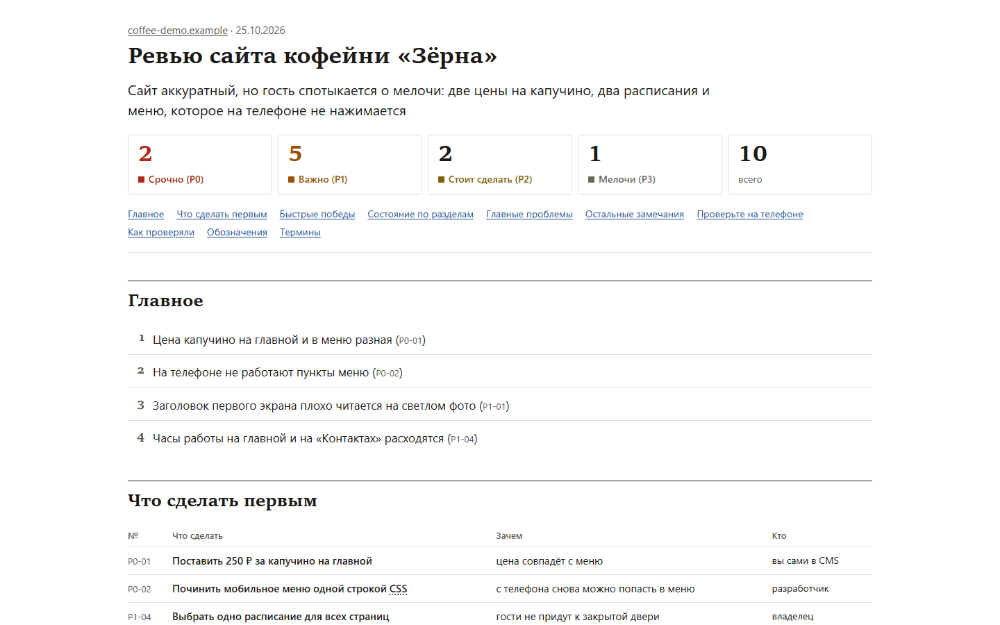
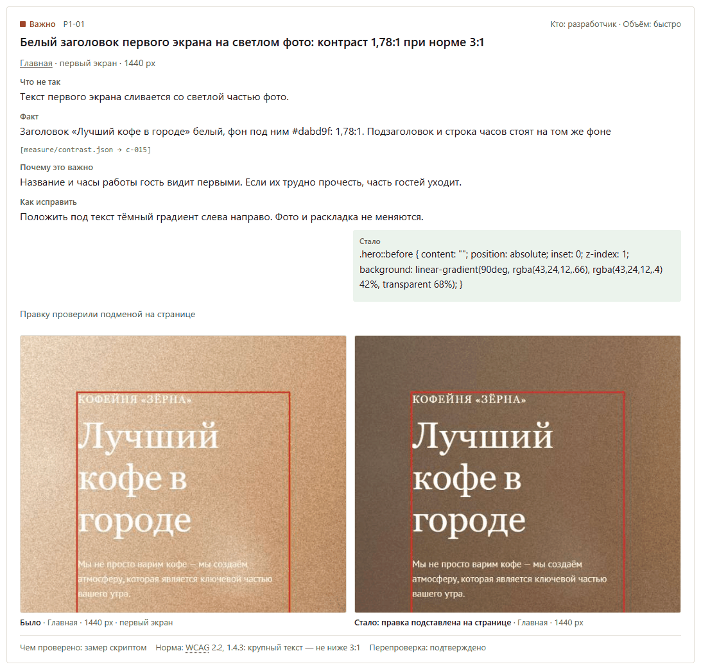
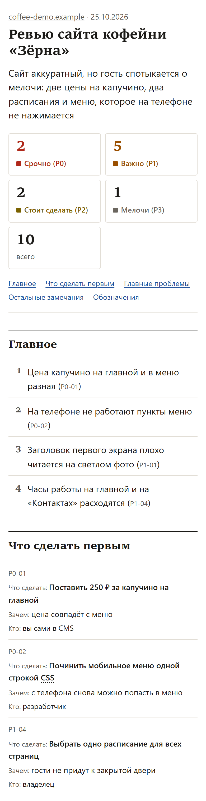
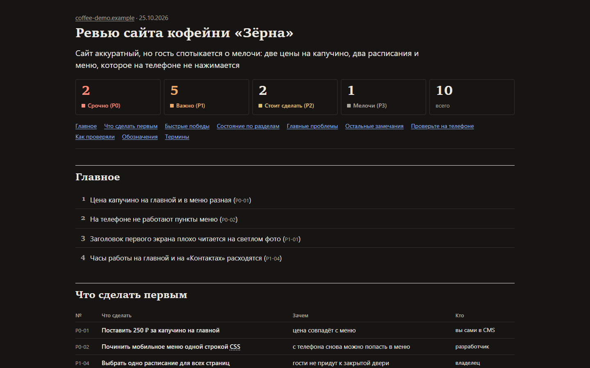
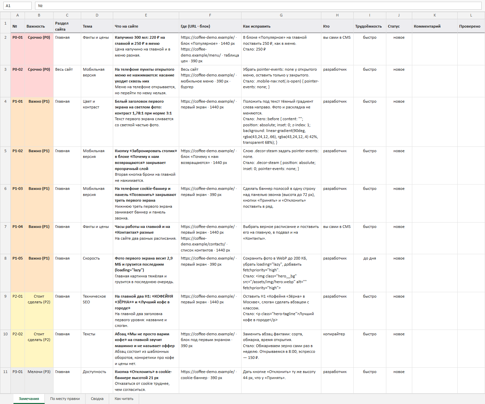

# Revizor

A Claude Code plugin: a team of agents reviews a website from every angle and builds an HTML report and an Excel registry.

Русская версия → [README.md](README.md)

- 18 review lenses, plus 2 that switch on by site type (shop, several languages).
- A skeptic re-measures every important finding the same way and tries to disprove it.
- A completeness critic looks for what was missed, a picky visitor looks at the site as a customer would, an editor builds the report.
- The site is only read: forms are never submitted, analytics and chat widgets are blocked, nothing on the site changes.



Report on the demo site from `examples/demo-site/`: the coffee shop and its address are fictional.

The plugin speaks Russian first: commands, questions and reports are in Russian by default; `--lang en` (or `lang: en` in setup) switches reports and script summaries to English. Norms cover Russia (Yandex, Russian law) and other markets (Google, GDPR/ePrivacy).

## What you get

| File | Contents |
|---|---|
| `report.html` | Single-file report: the gist, findings by severity (P0–P3) with screenshots and frames, what to check on your own phone |
| `registry.xlsx` | Findings registry: number, where, what is wrong, norm, how to fix, status. Hand it to a contractor and recheck the fixes later |
| `report.pdf` | Optional (`pdf` in the command) |



A finding card: what is wrong, the fact, the fix and before/after shots. The fix was tested by swapping it into the page; the site itself was not changed.

<p>


</p>

The same report on a phone and in dark mode.



The Excel registry: one row per finding, color by severity, a Status column to track fixes. The report and the registry in the pictures are in Russian, the plugin's default language.

Reports go to `~/Documents/Revizor/<site>/<date>/` (change the folder in `/revizor:setup`).

## Install

You need [Claude Code](https://docs.claude.com/en/docs/claude-code), Node.js 22 or newer and a Chromium-based browser (Chrome, Edge, Chromium, Brave, Yandex Browser).

In Claude Code:

```
/plugin marketplace add zzinziver/revizor
/plugin install revizor@revizor
/revizor:setup
```

`/revizor:setup` checks Node and the browser, asks about your subscription and defaults, offers narrow permission rules (one per plugin script, only with your consent) and a trial run on the demo site.

## Commands

| Command | What it does |
|---|---|
| `/revizor:full <url>` | Full review |
| `/revizor:quick <url> <topic>` | One topic on 1–3 pages: mobile, speed, copy, SEO, accessibility, forms and more |
| `/revizor:rivals <our url> [competitor urls]` | Competitor review: what to take, what to adapt, what to avoid |
| `/revizor:recheck [site or registry]` | Recheck fixes from a previous report: what is fixed, what broke again |
| `/revizor:setup` | Environment, defaults, permissions |

```
/revizor:full example.com --lang en
/revizor:full example.com --audience external --no-questions --pdf
/revizor:quick example.com/catalog mobile --lang en
/revizor:full --resume example.com
```

All words and flags: `plugins/revizor/skills/full/args.md`.

## Lenses

| Lens | Lens | Lens |
|---|---|---|
| Product and path to action | Facts and prices | Picky visitor |
| Scenarios and navigation | Visual design | Fonts and typography |
| Color and contrast | Mobile | Accessibility (WCAG 2.2 AA) |
| Copy and language | Technical SEO | Content SEO |
| Speed | Stability and code | Forms and analytics |
| Security (passive) | Privacy and cookies | Law (Russia and other markets) |
| Shop — for shops | Languages — for multilingual sites | |

Depth: `--depth lite` (home and 2 key pages, 11 agents), standard (home and up to 3 key pages: service or prices, contacts or booking, first menu item; 18 agents), `--depth deep` (up to 30 pages). More pages: `--pages 10`.

## Time and usage limits

A full review takes from an hour to several hours and uses a noticeable share of your subscription limit. A live run with 10 pages, balanced models and 6 agents at a time took about 3 h (scripts 49 min, agents about 2 h 15 min). The new default is 4 pages: about 25–30 min less for the scripts, estimate 1.5–3 h; not measured on a run yet. Before it starts, Revizor shows an estimate; depth can be chosen in the first questions. On Pro the defaults are lite depth and 3 agents at a time; an interrupted run continues with `--resume`.

The estimate lives in [`plugins/revizor/knowledge/cost.md`](plugins/revizor/knowledge/cost.md). It is based on agent counts, checked against one live run.

## Safety

| What | How |
|---|---|
| Forms | Never submitted. Any request other than GET is cut off before it leaves the browser, iframes included |
| Analytics, call tracking, chats | Blocked: the review does not spoil statistics or create leads |
| Clicks | Menus, tabs, accordions, calculators; navigation to another address after a click is cut off. Submit buttons and anything inside an iframe are never pressed |
| Local network | Private addresses are not opened, unless the site under review is itself local |
| Service paths (`/.git/`, `/.env` and the like) | Only with `--probe` and after you confirm the site is yours |
| Page text | Treated as data. Instructions for AI hidden on a page are not followed and are reported as a finding |

External services. Site data leaves your machine only to these services and only for a live public site: Yandex Speller (texts), PageSpeed Insights (page URLs), crt.sh, RDAP and dns.google (domain), web search by company name (can be switched off). Every call is written to the run's `log.md`. The axe-core accessibility library is downloaded once from a CDN with a hash check; no site data is sent. `REVIZOR_OFFLINE=1` switches off everything except the site itself.

## Self-test

`examples/demo-site/` is a fictional coffee shop with 93 planted issues and 17 traps. Check the scripts on it:

```
node plugins/revizor/scripts/selftest.mjs --lang en
```

Gates: the scripts find at least 80 % of the issues a measurement can find; no trap fires; the server log has no writes and no form submissions. Details (in Russian): `examples/demo-site/EXPECTED.md`. One call runs up to 9 minutes; if it does not finish, it exits with code 75 and continues with the same command plus `--resume`.

## claude.ai version

Without Claude Code you can use a claude.ai Project: knowledge files and instructions are in [`claude-ai/`](claude-ai/README.md). There are no scripts there; you send the screenshots.

## License

MIT, see [`LICENSE`](LICENSE). Some knowledge files are based on third-party work — [`THIRD_PARTY_NOTICES.md`](THIRD_PARTY_NOTICES.md).
